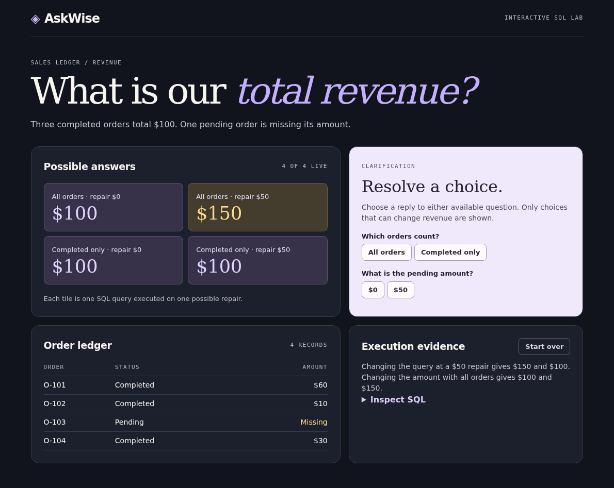

# AskWise

**Which clarification questions can change a SQL answer?**

AskWise considers several interpretations of a question and several possible repairs to the database. Before asking about a choice, it finds two executions that agree on the other choices and return different answers. Once all remaining possibilities agree, it returns their answer.

[Download the interactive lab](https://github.com/fmh1art/AskWise/raw/refs/heads/main/demo/index.html) · [Read the experiment report](results/E010/analysis.md) · [Explore the error audit](results/E011/summary.json)

[](https://github.com/fmh1art/AskWise/raw/refs/heads/main/demo/index.html)

## Try the revenue lab

Open the downloaded HTML file in a browser. The lab runs offline and includes the order ledger, both SQL queries, and the totals for all four combinations of query and repair.

- Choose **Completed only**. The three completed orders total **$100**, so the pending amount can stay unknown.
- Select **Start over**, then **All orders**. Both **$100** and **$150** are possible. Confirm **$50** for the pending order to see which executions survive.
- Try answering the amount question first. With a **$0** repair, both queries already give the same total.

To change the example, edit [the fixture generator](demo/build_fixture.py) and run `python demo/build_fixture.py`. It executes the SQL in SQLite and builds the lab's decision states using [the same relevance check as the experiments](a2/relevance.py).

## Experimental results

Across 120 fresh generated sales tasks, the exact bound reduced SQL executions relative to the partition bound. Asking as soon as a relevance witness was available used the fewest executions of these three policies, at the cost of slightly more questions.

| Policy | Mean SQL executions per episode |
| :--- | ---: |
| Partition bound, fixed order | 14.88 |
| Exact bound, fixed order | 13.80 |
| Immediate witness | 13.18 |

Each task has 16 hidden worlds. The [full comparison](results/E010/analysis.md) reports question costs, paired uncertainty across seeds, and separate results for 48 stress fixtures. The [AmbiQT candidate study](results/E003/summary.json) measures whether generated SQL recovers the reference answers on two database states. The [error audit](results/E011/annotations.json) provides query-level annotations for 100 sampled executable mismatches.

## Run the code

From the repository root with Python 3.12 and uv installed:

```bash
uv venv --python 3.12 .venv
uv pip install --python .venv/bin/python -r requirements.txt
.venv/bin/python -m pytest -q
.venv/bin/python scripts/run_e001.py
```

The last command runs the synthetic finite-world experiment locally. To reproduce the model study, consult the [candidate-generation protocol](experiments/E003-protocol.md) for dataset, API, and cache requirements. The [upstream AmbiQT repository](https://github.com/testzer0/AmbiQT) distributes the source annotations and databases.

## Repository guide

| Entry | What to look for |
| :--- | :--- |
| [Core algorithms](a2/) | Finite worlds, relevance witnesses, policy bounds, and evaluation |
| [Experiment protocols](experiments/) | Task construction, comparison policies, and audit procedures |
| [Experiment scripts](scripts/) | Run simulations, audit generated SQL, and produce paper tables |
| [Recorded results](results/) | Per-task measurements, summaries, and validation artifacts |
| [Research decisions](decisions.md) | Design history and interpretation of earlier runs |
| [Third-party notices](THIRD_PARTY_NOTICES.md) | Dataset and dependency provenance |
